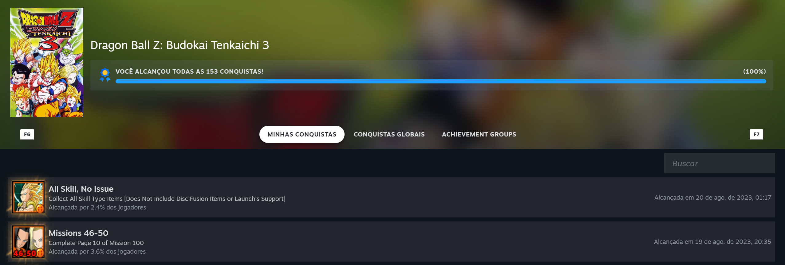
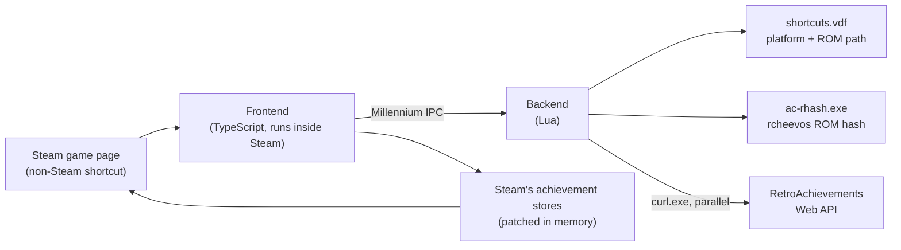
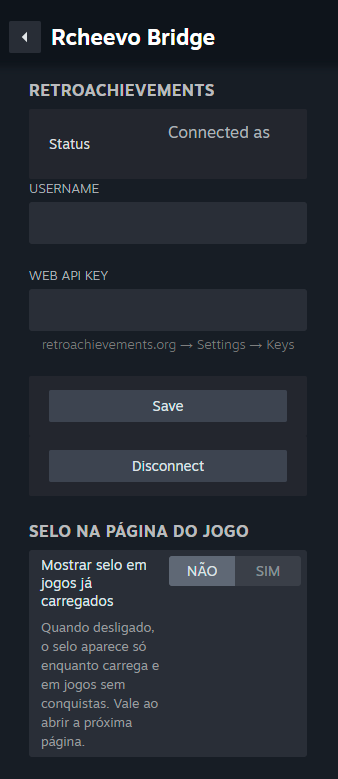
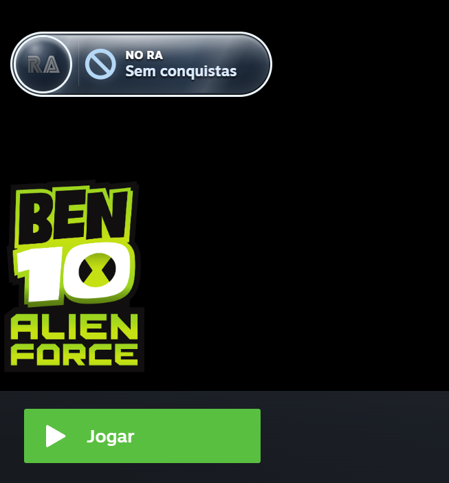
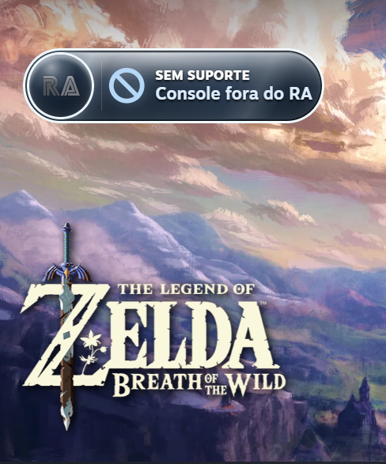

# Rcheevo Bridge

**RetroAchievements inside Steam's native achievement views, for your emulator shortcuts.**

[](LICENSE)


Rcheevo Bridge is a [Millennium](https://steambrew.app) plugin for the Steam desktop client on
Windows. When a non-Steam shortcut launches a ROM that [RetroAchievements](https://retroachievements.org)
recognizes, the game's achievements, unlock history and community stats show up in Steam's own
**Achievements**, **Activity** and **Community** views, as if it were a Steam game.

> **Based on [Achievement Companion](https://github.com/parvagans/achievement-companion)** by
> parvagans, a Decky Loader plugin for Steam Deck. Rcheevo Bridge is a port of its
> native-Steam-view integration to Millennium on Windows; see [Credits](#credits).
> It is an independent project, not affiliated with RetroAchievements, Valve or Millennium.

<p align="center">
  
</p>

## Contents

- [Features](#features)
- [How it works](#how-it-works)
- [Requirements](#requirements)
- [Installation](#installation)
- [Configuration](#configuration)
- [Game page badge](#game-page-badge)
- [Troubleshooting](#troubleshooting)
- [Known limitations](#known-limitations)
- [Privacy](#privacy)
- [Development](#development)
- [Project structure](#project-structure)
- [Credits](#credits)
- [License](#license)

## Features

- **Native Steam views.** RetroAchievements appear in Steam's own Achievements list, the
  Activity feed and the Community section of a shortcut's game page, with icons, descriptions,
  unlock times and global unlock rates.
- **Identification by ROM hash, never by title.** ROMs are hashed with
  [rcheevos](https://github.com/RetroAchievements/rcheevos), the same rules RetroAchievements
  emulators use, so a renamed shortcut still matches and a wrong revision is not guessed.
- **Works with EmuDeck for Windows and Steam ROM Manager** shortcuts, including EmuDeck's
  PowerShell launcher command lines.
- **Fast after the first visit.** Shortcut identities are remembered, catalogue and community data
  are cached on disk, and a game's achievements are shown before its community stats finish
  loading.
- **Background pre-identification.** Shortly after Steam starts, every shortcut is identified in
  the background so first visits do not wait for the console catalogue.
- **Game page badge** that explains shortcuts without achievements (platform or game not on
  RetroAchievements, game without achievements yet, ROM not found) and shows loading progress.

## How it works



1. **Detect the shortcut.** When a game page opens, the frontend asks the backend for the
   shortcut's entry in Steam's `shortcuts.vdf`: its Steam category (for example
   `Sony Playstation 2`) gives the RetroAchievements console, and its launch command gives the ROM
   path.
2. **Hash the ROM.** The backend runs the bundled `ac-rhash.exe`, which applies the console's
   rcheevos hashing rules (cartridge ROMs, ISO, CHD, CSO/ZSO, M3U playlists).
3. **Find the game.** The hash is looked up in the console's RetroAchievements catalogue. The
   answer is remembered, so later visits skip this step.
4. **Load progress.** Your progress for that game comes from the RetroAchievements Web API, with
   your API key added by the backend.
5. **Show it natively.** The frontend patches Steam's in-memory achievement stores for that
   shortcut, so Steam renders the achievements with its own components. Community stats arrive
   afterwards and fill the Community section in place.

## Requirements

- Windows 10 version 1803 or later, or Windows 11 (the backend uses the bundled `curl.exe`).
- Steam with [Millennium](https://steambrew.app) 3.x.
- A [RetroAchievements](https://retroachievements.org) account and its **Web API key**
  (retroachievements.org → *Settings* → *Keys*).
- Non-Steam shortcuts whose Steam category names the platform, as EmuDeck and Steam ROM Manager
  create them.

## Installation

### From a release

1. Download the latest release from the [Releases](../../releases) page and extract it.
2. Copy its `rcheevo-bridge` folder to `C:\Program Files (x86)\Steam\millennium\plugins\`.
3. In Steam, enable **Rcheevo Bridge** in Millennium's plugin list.
4. Close Steam with **Steam → Exit** and open it again (see
   [Troubleshooting](#troubleshooting) about Millennium's restart prompt).

### From source

See [Development](#development) to build, then copy the plugin from an elevated PowerShell:

```powershell
robocopy millennium "C:\Program Files (x86)\Steam\millennium\plugins\rcheevo-bridge" /E /XD frontend /XF *.pdb *.map
```

## Configuration

Open Millennium's settings in Steam and select **Rcheevo Bridge**:

| Setting | Description |
|---|---|
| Username / Web API key | Your RetroAchievements credentials. The key is checked against the API before it is saved. |
| Show badge on loaded games | Off by default: the badge shows while a game loads and for shortcuts without achievements, then hides. Turn on to keep it visible with your progress. |

<p align="center">
  
</p>

## Game page badge

| Badge | Meaning |
|---|---|
| *loading ring* | The shortcut is being identified or its progress is loading. |
| **SEM SUPORTE** · Jogo fora do RA | The ROM hash is not in RetroAchievements. |
| **NO RA** · Sem conquistas | The game exists on RetroAchievements but has no achievements yet. |
| **SEM SUPORTE** · Console fora do RA | RetroAchievements does not support the platform (e.g. Nintendo Switch). |
| **ROM** · Não encontrada | The ROM path in the shortcut could not be read. |
| **ROM** · ZIP não suportado | ROMs inside `.zip` archives are not hashed yet. |
| **ROM** · Não identificada | The ROM could not be hashed or matched unambiguously. |

Network or credential problems never show a badge, so a temporary failure is not mistaken for a
game without achievements. Badge texts are currently in Portuguese.

<table>
  <tr>
    <th width="50%">Game on RetroAchievements without achievements</th>
    <th width="50%">Platform not supported by RetroAchievements</th>
  </tr>
  <tr>
    <td width="50%"></td>
    <td width="50%"></td>
  </tr>
</table>

## Troubleshooting

**Achievements take ~4 s longer with other plugins enabled.** Millennium delivers backend calls
for all plugins through one channel. Plugins that make slow requests when a game page opens (for
example *HLTB for Steam*, which searches HowLongToBeat by title) delay Rcheevo Bridge's calls
until they finish. Disable such plugins if the delay matters to you.

**Steam has no window after enabling the plugin.** Restarting through Millennium's prompt has left
Steam running without a window. End `steam.exe`, `steamwebhelper.exe` and
`millennium.luavm64.exe` in Task Manager and start Steam again; prefer **Steam → Exit** to restart.

**A game shows "SEM SUPORTE · Jogo fora do RA" but it is on RetroAchievements.** Rcheevo Bridge
only matches ROMs whose hash RetroAchievements lists for the game. Check the game's *Supported
Game Files* on retroachievements.org; a different revision or a patched dump will not match.

**Logs.** Backend messages appear in Millennium's log viewer under the plugin. Frontend messages
are written by Steam to `Steam\logs\webhelper_js.txt`.

## Known limitations

- Windows only.
- ROMs inside `.zip` archives, and compressed GameCube/Wii images (RVZ, WIA, GCZ, WBFS), are not
  hashed. Plain ISO images work.
- ROM paths with non-ASCII characters may fail to hash.
- Clicking the game page badge does nothing yet.
- Badge texts are in Portuguese only.

## Privacy

- Rcheevo Bridge talks only to `retroachievements.org`.
- Your Web API key is stored **unencrypted** in `%APPDATA%\rcheevo-bridge\` (Millennium's
  Lua runtime has no encryption primitives) and is never sent to the Steam UI. Temporary request
  files that contain it are deleted right after each batch.
- Cached RetroAchievements data (catalogues, community stats, other players' public profiles) is
  stored in `%APPDATA%\rcheevo-bridge\cache\`. Your own progress is never cached on disk.
- Rcheevo Bridge does not provide ROMs, BIOS files or other game content.

## Development

Requirements: [Node.js](https://nodejs.org) with [pnpm](https://pnpm.io), Git, and
[Zig](https://ziglang.org) (as a C compiler for the ROM hash helper).

```powershell
pnpm install
pnpm run build          # frontend bundle → millennium/.millennium/Dist/index.js
pnpm run build:ra-hash  # ROM hash helper → millennium/bin/ac-rhash.exe
pnpm run typecheck
pnpm test
```

The Lua backend in `millennium/backend/` needs no build step; it runs on Millennium's Lua runtime
with its `http`, `fs`, `json` and `utils` modules.

## Project structure

| Path | Contents |
|---|---|
| `millennium/plugin.json` | Millennium plugin manifest. |
| `millennium/frontend/` | Plugin entry point, settings panel, and the compatibility layer that runs the inherited UI code on `@steambrew/client`. |
| `millennium/backend/` | Lua backend: credentials, RetroAchievements requests (disk-cached, fetched in parallel), shortcut parsing and ROM hashing. |
| `src/` | TypeScript inherited from Achievement Companion: RetroAchievements provider, native Steam view integration, game page badge. |
| `native/ra_hash/` | C helper that hashes ROMs with rcheevos. `windows/` stubs the GameCube/Wii disc library. |
| `scripts/` | Windows helper build, post-build asset inlining, test runner. |
| `tests/` | Node test suite for the inherited TypeScript code. |

## Credits

- **[Achievement Companion](https://github.com/parvagans/achievement-companion)** by parvagans:
  the RetroAchievements provider, ROM identification pipeline, native Steam view integration and
  badge that Rcheevo Bridge is built on. If you use a Steam Deck, use Achievement Companion.
- **[RetroAchievements](https://retroachievements.org)** and
  **[rcheevos](https://github.com/RetroAchievements/rcheevos)** for the achievement data and ROM
  hashing rules.
- **[Millennium](https://steambrew.app)** for the Steam client plugin runtime.
- [libchdr](https://github.com/rtissera/libchdr) and [lz4](https://github.com/lz4/lz4), linked
  into the ROM hash helper.

## License

[BSD 3-Clause](LICENSE), as Achievement Companion. Third-party notices are in
[THIRD_PARTY_NOTICES.md](THIRD_PARTY_NOTICES.md) and [`licenses/`](licenses/).

RetroAchievements is a trademark of its respective owner; Steam is a trademark of Valve
Corporation. Rcheevo Bridge is not affiliated with or endorsed by either.
